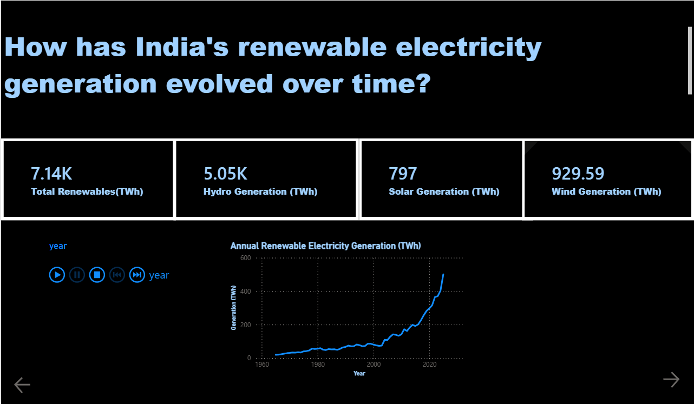
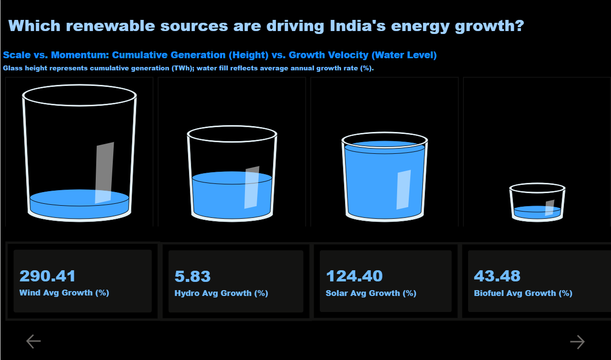
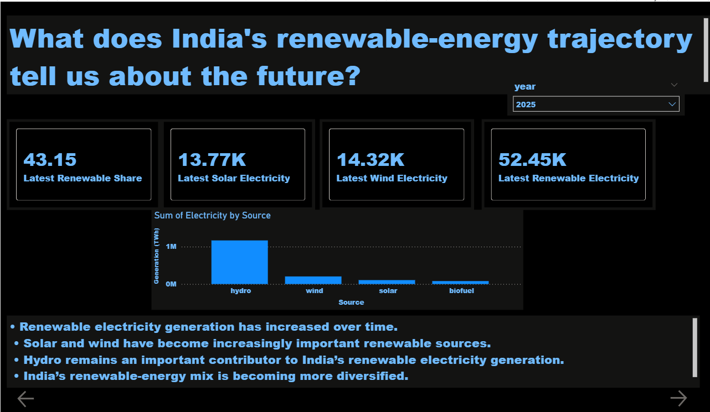

# India's Renewable Energy Transition (Power BI Executive Dashboard)

For centuries, India has relied heavily on conventional energy sources such as coal and petroleum to meet its energy needs.
But these resources are finite and take millions of years to form. As energy demand continues to grow, depending heavily on fossil fuels leads to long-term sustainability challenges.

An interactive 4-page Power BI executive dashboard analyzing multi-decade clean energy generation, capacity mix, and growth velocity across **Hydro, Wind, Solar, and Bioenergy** in India (2000–Present).

---

## Dashboard Preview

| HOME | TRAJECTORY |
| :---: | :---: |
|  |  |

| ENERGY MIX | GROWTH |
| :---: | :---: |
|  |  |

| INSIGHTS |
| :---: |
|  |

---

## Key Analytical Insights

* **Legacy Baseline vs. Modern Momentum:** Hydropower accounts for the largest cumulative historical generation (1,550+ TWh) due to decades of installed capacity, while maintaining steady, mature single-digit annual growth (~5.8%).
* **Exponential Solar Acceleration:** Following policy and infrastructure expansion post-2014, Solar energy exhibits the highest annualized growth velocity (+25% to +40% YoY), rapidly closing the capacity gap.
* **Balanced Wind Expansion:** Wind power provides a consistent secondary pillar in India's clean energy mix, combining moderate historical volume with steady double-digit compound growth.

---

## Technical Architecture & Features

* **Data Source:** [Our World in Data (OWID) — Energy Dataset](https://ourworldindata.org/energy) (`owid-energy-data.csv`), filtered and modeled for India's renewable electricity generation metrics.
* **Data Modeling & Transformation:** Unpivoted multi-source energy columns into a clean, normalized `energy mix` table in Power Query to enable dynamic cross-filtering across fuel categories.
* **Custom DAX Measures:**
  * Cumulative generation volume calculations normalized to **Terawatt-hours (TWh)** using custom format strings (`#,##0.00 "TWh"`).
  * Year-over-Year (YoY) growth velocity and latest-year benchmark KPI cards (`Latest Solar`, `Latest Wind`, `Latest Renewable`).
* **Custom Visuals & UI/UX:**
  * **Scale vs. Momentum (Water Cup Visual):** Dual-metric comparative visual mapping cumulative volume (vessel height) against annualized growth rate (water fill level).
  * **Animated Timeline (Play Axis):** Interactive time-series playback tracking generation shifts from 2000 onward.
  * **High-Contrast Dark Theme:** Custom dark-mode canvas with cyan/blue visual accents, custom report tooltips, and grouped element anchoring.

---

## Repository Structure

```text
├── Images/
│   ├── ENERGY MIX.png
│   ├── GROWTH.png
│   ├── HOME PAGE.png
│   ├── INSIGHTS.png
│   └── TRAJECTORY.png
├── RENEWABLE ENERGY.pbix        # Main Power BI Desktop report file
├── owid-energy-data.csv         # Our World in Data energy dataset
└── README.md                    # Project documentation
